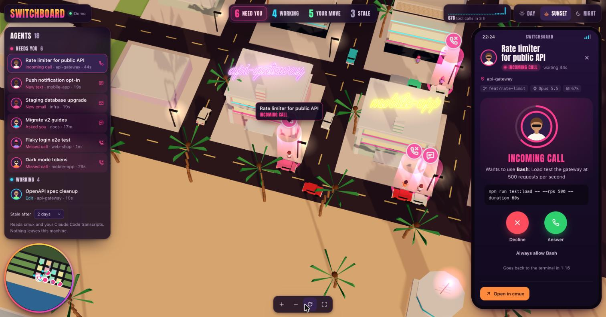

# Switchboard

A live local dashboard for the agents running in [cmux](https://cmux.com), drawn as a sun-soaked coastal city. Every git repository owns one lot on a beachfront grid, every agent is a lit floor of that lot's hotel plus a person and their car, and what they are doing tells you the agent's state: out driving while it works, pulled over and phoning you when it needs you, waiting at the door when it's your move, gone inside with the blinds down when it goes stale. Click anyone to fly to them and pick up the call.



## Run it

Start it from a cmux terminal, because cmux only accepts socket connections from its own terminals:

```bash
cd ~/code/cmux-dashboard
npm start                                 # http://localhost:4747
cmux browser open http://localhost:4747   # optional: open it as a cmux split
```

It needs Node 20 or later and has no npm dependencies. Three.js and the fonts are vendored in `public/`, so nothing is downloaded at runtime. Use `PORT=5000 npm start` for another port.

To try it without cmux, or to take screenshots without showing your real sessions, run `npm run demo`. It serves made-up projects and agents in every state that keep working, finishing and asking for things on their own.

## Reading the city

| You see | It means |
| --- | --- |
| Pink light column, a person on the phone beside their car with hazards on | **Needs you.** The badge says how they reach you: a call is a permission, a text is a question, an email is a plan to approve, a missed call is a result you haven't read, a terminal is a prompt only the terminal can answer. Badges stay the same size at any zoom, and the minimap pins them to its edge when they're off screen. |
| Car driving the streets, floor windows lit | **Working.** Brake lights flash on every tool call. |
| Car parked out front, person at the hotel door | **Your move.** Finished and waiting for your next message. |
| Blinds down, car under a cover | **Stale.** No activity for longer than "Stale after". |

- **Lots:** one per git repository, found with `git rev-parse --git-common-dir`, so worktrees join their repo. Sessions outside any repo share the **hangout** motel.
- **Floors:** each agent adds a floor (up to six, then a "+N" sign), so the skyline shows where the work is. The repo name glows on the roof.
- **Building style:** beachfront hotels in the first row, downtown towers in the second, stilt houses by the swamp after that.
- **Stable positions:** a lot keeps its place (also across reloads), and a closed repo's lot goes up for sale until the next new repo takes it, so nothing else moves.
- **Phone:** selecting an agent opens it. Answer a call to allow (Decline denies, "Always allow" is under the buttons), tap a reply to a text, approve the emailed plan, or text back an idle agent. A ring counts down cmux's ~120-second window before the decision falls back to the terminal.
- **Job done:** a banner announces each finished job.
- **Controls:** drag to pan, scroll or pinch to zoom, right-drag (or Shift-drag) to rotate, double-click to zoom in on a spot. Click a person, car, floor or marker to select it, a lot to zoom to it, or the minimap to move there. Keys: `N` next agent that needs you, `F` show everything, `+`/`-` zoom, `Q`/`E` rotate, `W` `A` `S` `D` pan, `Esc` close.
- **Time of day:** Day, Sunset or Night, at the top right.

Everything is also in the agent list on the left, which works with the keyboard and without the 3D view. On narrow windows it folds behind the **Agents** button and the phone becomes a bottom sheet. With reduced motion on, nobody drives or walks and the camera cuts instead of flying.

## What it tracks

| State | Meaning |
| --- | --- |
| Needs you | A permission, question or plan prompt is open; or the agent finished with a question; or there is an unread cmux notification. Longest wait first. |
| Working | The agent is mid-turn. Shows what it is doing now, how long the turn has run, and its recent tool calls as signal bars on the phone. |
| Your move | Finished and idle. Shows Claude's recap (the `※ recap` line) or the start of its last reply. |
| Stale | No activity for longer than the "Stale after" setting (2 days by default). |
| No agent | Terminals without an agent. |

The phone also shows the project folder, git branch, model, context size, permission mode and any dev-server ports (as links).

## What you can do from the phone

- **Open in cmux:** focuses that workspace and terminal and brings cmux to the front.
- **Allow once / Always allow / Deny**, **answer a question**, **approve a plan:** sent through cmux's Feed (`feed.permission.reply`, `feed.question.reply`, `feed.exit_plan.reply`). cmux holds these for about 120 seconds; after that the agent falls back to its terminal prompt and the card says to answer there.
- **Reply:** types your text into the agent's prompt and presses Enter (`cmux paste --submit`). The server re-checks first and refuses unless the agent is idle and its prompt box is empty, so it never mixes into a draft or interrupts a turn.
- **Mark read:** clears that workspace's cmux notifications.

## Where the data comes from

- `cmux current --json`: terminals, agents, session ids, working/idle state.
- `cmux rpc workspace.list`: titles, sidebar order, listening ports, last prompt.
- `cmux rpc feed.list`: open decisions and tool-call activity.
- `cmux rpc notification.list`: unread state.
- `cmux list-status`: the sidebar status per workspace (Running, Waiting, Needs permission).
- `cmux events --reconnect`: live hook events, used to refresh within a second and to flash cards on each tool call.
- `~/.claude/projects/*/<session>.jsonl` (read-only, last 2 MB): last reply, recap, last prompt, model, context tokens, branch, the tool currently running, and pending questions or plans.

## Safety

- Listens on `127.0.0.1` only and rejects requests whose `Host` is not `localhost` or `127.0.0.1` (blocks DNS rebinding).
- Every action needs a random token that is generated at startup and only embedded in the page itself, plus a JSON body and a same-origin `Origin`. Other websites can't trigger actions.
- Permission replies offer only Once, Always and Deny. The Feed's "All tools" and "Bypass" modes are left out on purpose.
- Nothing is sent anywhere except to the local cmux socket.

## Tested

Checked against cmux 0.65.2 and Claude Code 2.1.322 with a throwaway Haiku session: allowing a Bash permission, replying, and answering an AskUserQuestion prompt all worked from the dashboard. Approving a plan uses the same Feed mechanism but has not been tried.

## License

MIT. See [LICENSE](LICENSE).

## Credits

- [Three.js](https://threejs.org) 0.186.1, MIT licence (`public/vendor/three.LICENSE`).
- [Anton](https://fonts.google.com/specimen/Anton) font, SIL Open Font Licence 1.1 (`public/fonts/anton.LICENSE`).
- [Yellowtail](https://fonts.google.com/specimen/Yellowtail) font, Apache Licence 2.0 (`public/fonts/yellowtail.LICENSE`).
